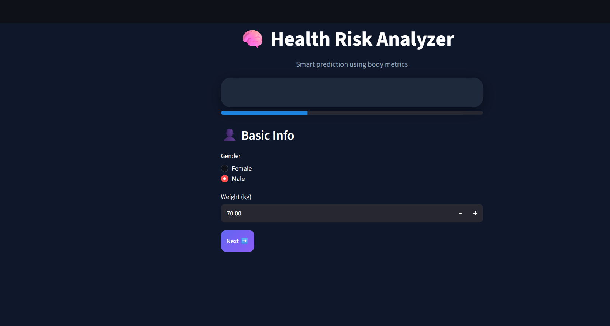
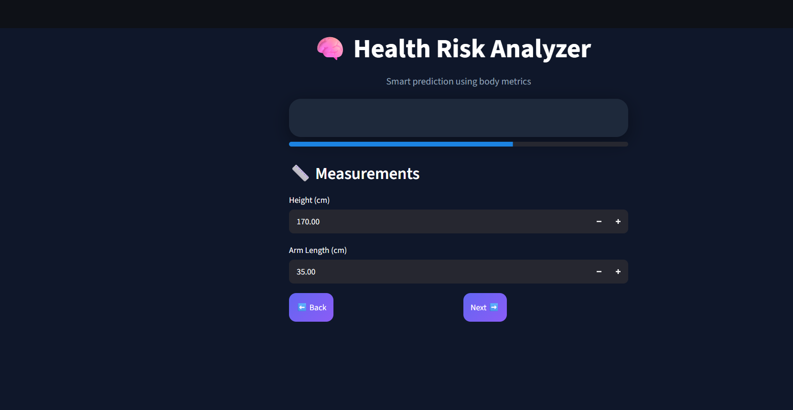
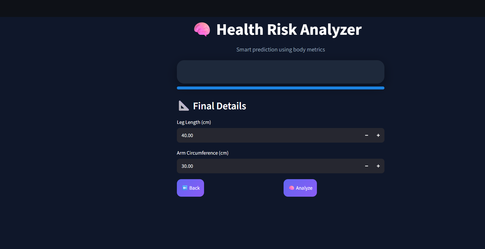
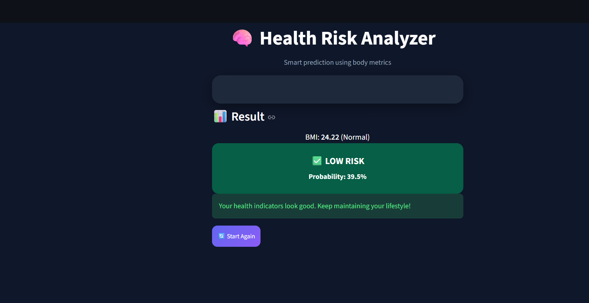

# 🧮 BMI Health Predictor

## Interactive BMI Analysis & Health Risk Assessment Application

BMI Health Predictor is an interactive **Streamlit-based health analytics application** that analyzes user-provided body measurements and presents BMI and health-risk insights through a clean, user-friendly web interface.

The application guides users through a step-by-step assessment process, collects basic information and body measurements, calculates BMI, classifies the BMI category, and presents a health-risk result with a probability score.

> **Project Note:** This application is intended for educational and informational purposes. The health-risk prediction is a demonstration and should not be considered a medical diagnosis or a substitute for professional medical advice.

---

## 🚀 Live Demo

**Live Application:**

https://bmi-health-predictor.streamlit.app/

**GitHub Repository:**

https://github.com/balajigs08/bmi-calculator

---

## 📸 Application Screenshots

### 🏠 Step 1 — Basic Information

Users begin by entering their basic information, including gender and weight.



---

### 📏 Step 2 — Measurements

The application collects physical measurements such as height and arm length.



---

### 📐 Step 3 — Final Details

Additional body measurements are collected before performing the health analysis.



---

### 📊 Step 4 — Health Risk Result

After analyzing the provided information, the application displays the BMI value, BMI category, health-risk classification, and probability score.



---

## ✨ Key Features

### 🧮 BMI Calculation

- Accepts user height and weight.
- Calculates Body Mass Index (BMI).
- Displays the calculated BMI value.
- Classifies the result into a standard BMI category.

### 🧍 Body Measurement Analysis

The application collects multiple body-related inputs, including:

- Gender
- Weight
- Height
- Arm length
- Leg length
- Arm circumference

These measurements are used as inputs for the application's health-risk analysis workflow.

### 📊 BMI Classification

The application presents BMI according to commonly used general categories:

| BMI Range | Category |
|---|---|
| Below 18.5 | Underweight |
| 18.5 – 24.9 | Normal Weight |
| 25.0 – 29.9 | Overweight |
| 30.0 and above | Obesity |

### 🧠 Health Risk Prediction

- Analyzes the provided body measurements.
- Produces a health-risk classification.
- Displays a probability score.
- Provides a simple interpretation of the result.

### 🖥️ Interactive Streamlit Interface

- Step-by-step input workflow.
- Interactive controls for entering measurements.
- Progress indicator between assessment stages.
- Clean and modern dark-themed interface.
- Immediate results after analysis.

### ☁️ Cloud Deployment

The application is deployed using **Streamlit Community Cloud**, making it accessible directly through a web browser.

---

## 🖥️ Application Workflow

```text
                    ┌─────────────────────┐
                    │        User         │
                    └──────────┬──────────┘
                               │
                               ▼
                    ┌─────────────────────┐
                    │  Basic Information  │
                    │ Gender & Weight     │
                    └──────────┬──────────┘
                               │
                               ▼
                    ┌─────────────────────┐
                    │    Measurements     │
                    │ Height & Arm Length │
                    └──────────┬──────────┘
                               │
                               ▼
                    ┌─────────────────────┐
                    │   Final Details     │
                    │ Leg Length & Arm    │
                    │ Circumference       │
                    └──────────┬──────────┘
                               │
                               ▼
                    ┌─────────────────────┐
                    │   Health Analysis   │
                    └──────────┬──────────┘
                               │
                 ┌─────────────┴─────────────┐
                 ▼                           ▼
        ┌─────────────────┐        ┌──────────────────┐
        │ BMI Calculation │        │ Health Risk      │
        │ & Classification│        │ Prediction       │
        └────────┬────────┘        └────────┬─────────┘
                 │                          │
                 └────────────┬─────────────┘
                              ▼
                    ┌─────────────────────┐
                    │   Display Results   │
                    │ BMI + Risk + Score  │
                    └─────────────────────┘
```

---

## 🛠️ Technology Stack

### Programming Language

- Python

### Framework

- Streamlit

### Libraries

- Pandas
- NumPy
- Scikit-learn

### Development Tools

- Visual Studio Code
- Git
- GitHub

### Deployment

- Streamlit Community Cloud

---

## 📁 Project Structure

```text
bmi-calculator/
│
├── app.py
├── requirements.txt
├── README.md
│
└── screenshots/
    ├── home-page.png
    ├── measurements.png
    ├── final-details.png
    └── result.png
```

> The exact project structure may vary depending on the files included in the repository.

---

## ⚙️ Installation & Setup

### 1. Clone the Repository

```bash
git clone https://github.com/balajigs08/bmi-calculator.git
```

### 2. Navigate to the Project

```bash
cd bmi-calculator
```

### 3. Create a Virtual Environment

```bash
python -m venv venv
```

### 4. Activate the Virtual Environment

#### Windows

```bash
venv\Scripts\activate
```

#### macOS / Linux

```bash
source venv/bin/activate
```

### 5. Install Dependencies

```bash
pip install -r requirements.txt
```

### 6. Run the Application

```bash
streamlit run app.py
```

The application will typically be available at:

```text
http://localhost:8501
```

---

## 📐 BMI Formula

BMI is calculated using the following formula:

```text
BMI = Weight (kg) / Height² (m²)
```

For example, if a person weighs **70 kg** and has a height of **1.75 m**:

```text
BMI = 70 / (1.75 × 1.75)
BMI ≈ 22.86
```

This falls within the **Normal Weight** category.

---

## 📊 BMI Categories

```text
BMI < 18.5
      ↓
Underweight

18.5 – 24.9
      ↓
Normal Weight

25.0 – 29.9
      ↓
Overweight

BMI ≥ 30
      ↓
Obesity
```

---

## 🔐 Input Validation

The application validates user inputs to help ensure:

- Height values are valid.
- Weight values are valid.
- Body measurements are numeric.
- Invalid or unrealistic values are handled appropriately.
- Calculation errors are minimized.

---

## 🎯 Project Objectives

The main objectives of this project are:

- Build an interactive health analytics application.
- Implement BMI calculation using Python.
- Analyze multiple body measurements.
- Develop a step-by-step Streamlit interface.
- Apply classification and prediction logic.
- Present health-risk results in an understandable format.
- Practice numerical and data-processing techniques.
- Deploy a Python application to the cloud.
- Gain practical experience with Git and GitHub.

---

## 🔮 Future Enhancements

Potential improvements include:

- BMI trend tracking
- User profiles
- Historical BMI records
- Interactive BMI charts
- Personalized health recommendations
- Age-aware assessment
- Nutrition suggestions
- Workout recommendations
- Database integration
- User authentication
- Improved machine-learning models
- Downloadable health reports
- Mobile-friendly enhancements
- Advanced health analytics dashboard

---

## ⚠️ Disclaimer

This application is intended for **educational and informational purposes only**.

BMI is a general screening measure and does not directly measure body fat or overall health. The health-risk results generated by this project are intended for demonstration purposes and should not be considered a medical diagnosis or a substitute for professional medical advice.

---

## 👨‍💻 Developer

### Balaji GS

**MCA Student | Full Stack Developer | Data Analytics Enthusiast**

**GitHub:**

https://github.com/balajigs08

**LinkedIn:**

https://www.linkedin.com/in/balajigs8

**Live Project:**

https://bmi-health-predictor.streamlit.app/

---

## ⭐ Support

If you find this project useful or interesting, consider giving the repository a ⭐ on GitHub.

Your feedback and suggestions are always welcome.

---

## 📜 License

This project was developed for educational and demonstration purposes.

© 2026 Balaji GS. All rights reserved.
